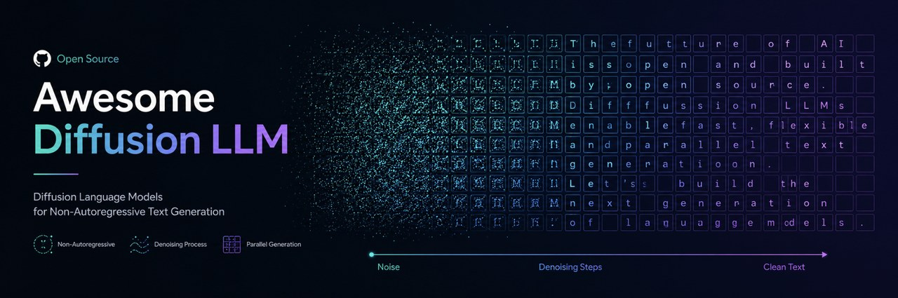

  
  <h1>🌀 Awesome Diffusion LLM</h1>
  
A curated list of diffusion language models (dLLMs): the papers, models, and code behind diffusion-based, non-autoregressive text generation, with a focus on 2025–2026.

  

    
    
    
    
    
  

---

**Diffusion language models (dLLMs)** generate text by iterative denoising instead of left-to-right decoding — enabling parallel generation, any-order infilling, and self-correction. Once a research curiosity, 2025–2026 brought 8B–100B open models and commercial systems hitting 1000+ tokens/sec. This list tracks the papers, models, and code behind the shift.

> Found a great model or paper we missed? [Contributions welcome](CONTRIBUTING.md).

---

## 📚 Contents

- [📊 Surveys & Overviews](#-surveys--overviews)
- [🏛️ Foundations](#️-foundations)
- [🚀 Open Diffusion LLMs & Models](#-open-diffusion-llms--models)
- [🏋️ Training & Scaling Methods](#️-training--scaling-methods)
- [⚡ Inference, Decoding & Acceleration](#-inference-decoding--acceleration)
- [🖼️ Multimodal Diffusion LMs](#️-multimodal-diffusion-lms)
- [🧠 Reasoning & Code with Diffusion LMs](#-reasoning--code-with-diffusion-lms)
- [📏 Benchmarks & Evaluation](#-benchmarks--evaluation)
- [💻 Code & Implementations](#-code--implementations)
- [📚 Related Awesome Lists](#-related-awesome-lists)

## 📊 Surveys & Overviews

- [Discrete Diffusion in Large Language and Multimodal Models: A Survey](https://arxiv.org/abs/2506.13759) — The first survey dedicated to discrete diffusion spanning both LLMs and multimodal models; the canonical taxonomy reference with a maintained companion repo (2025).
- [A Survey on Diffusion Language Models](https://arxiv.org/abs/2508.10875) — Broad "start here" overview organizing the field into continuous, discrete, and multimodal DLMs, with a high-traffic companion list and updates running into 2026 (2025).

## 🏛️ Foundations

- [Argmax Flows and Multinomial Diffusion: Learning Categorical Distributions](https://arxiv.org/abs/2102.05379) — The earliest discrete-diffusion lineage paper, introducing multinomial diffusion (adding/removing categorical noise directly in vocabulary space); D3PM is a direct generalization of it (2021).
- [Structured Denoising Diffusion Models in Discrete State-Spaces (D3PM)](https://arxiv.org/abs/2107.03006) — Foundational framework that corrupts tokens via Markov transition matrices (uniform, nearest-neighbor, and crucially absorbing/[MASK] states), unifying discrete diffusion with autoregressive and masked-LM generation (2021).
- [Diffusion-LM Improves Controllable Text Generation](https://arxiv.org/abs/2205.14217) — The paper that put diffusion on the NLP map: diffuses in continuous word-embedding space and exploits the smooth latent trajectory for plug-and-play gradient-based controllable generation (2022).
- [Analog Bits: Generating Discrete Data using Diffusion Models with Self-Conditioning](https://arxiv.org/abs/2208.04202) — "Bit diffusion": encodes tokens as continuous "analog bits" and introduces self-conditioning (the model conditions on its own prior prediction), a trick later adopted broadly across text diffusion (2022).
- [DiffuSeq: Sequence to Sequence Text Generation with Diffusion Models](https://arxiv.org/abs/2210.08933) — Extends continuous embedding diffusion to conditional seq2seq via partial noising (only the target is corrupted), making diffusion usable for translation/paraphrase/QA without a separate classifier (2022).
- [SSD-LM: Semi-autoregressive Simplex-based Diffusion Language Model](https://arxiv.org/abs/2210.17432) — Diffuses over the simplex on the actual vocabulary (not a learned latent) and generates block-by-block, enabling flexible length and off-the-shelf classifier guidance with no adaptation (2022).
- [Continuous Diffusion for Categorical Data (CDCD)](https://arxiv.org/abs/2211.15089) — DeepMind framework continuous in both time and input space, with score interpolation and a learned per-token time-warping noise schedule; an influential continuous-embedding recipe for language (2022).
- [DiffusionBERT: Improving Generative Masked Language Models with Diffusion Models](https://arxiv.org/abs/2211.15029) — Bridges pretrained BERT and absorbing-state discrete diffusion with an information-aware "spindle" schedule that masks tokens by informativeness; early proof that MLM weights bootstrap text diffusion (2022).
- [A Reparameterized Discrete Diffusion Model for Text Generation (RDM)](https://arxiv.org/abs/2302.05737) — Derives an equivalent reformulation of discrete-diffusion sampling yielding a cleaner training objective and a better adaptive decoding/routing strategy, sharpening both training and inference (2023).
- [Likelihood-Based Diffusion Language Models (Plaid)](https://arxiv.org/abs/2305.18619) — First serious attempt to close the likelihood gap with AR models via training improvements, scaling laws, and compute; ships Plaid 1B, the first diffusion LM to beat GPT-2 124M on likelihood (2023).
- [Discrete Diffusion Modeling by Estimating the Ratios of the Data Distribution (SEDD)](https://arxiv.org/abs/2310.16834) — ICML 2024 best paper: introduces score entropy, generalizing score matching to discrete spaces by learning token-probability ratios, cutting perplexity 25–75% over prior text diffusion and rivaling GPT-2 (2023).
- [Simple and Effective Masked Diffusion Language Models (MDLM)](https://arxiv.org/abs/2406.07524) — Shows plain absorbing-state masked diffusion, with a substitution parameterization and a Rao-Blackwellized objective reducing to a weighted mixture of MLM losses, approaches AR perplexity and beats SEDD (2024).
- [Simplified and Generalized Masked Diffusion for Discrete Data (MD4)](https://arxiv.org/abs/2406.04329) — DeepMind's clean unification: proves the continuous-time masked-diffusion objective is just a weighted integral of cross-entropy losses, generalizing to state-dependent schedules; SOTA among diffusion LMs at GPT-2 scale (2024).

## 🚀 Open Diffusion LLMs & Models

- [LLaDA: Large Language Diffusion Models](https://arxiv.org/abs/2502.09992) — The breakout result: first 8B masked-diffusion LLM trained from scratch (2.3T tokens) to rival LLaMA3-8B, and it beats GPT-4o on reversal-curse tasks thanks to bidirectional any-order generation — the strongest evidence diffusion is a viable AR alternative (2025).
- [Block Diffusion: Interpolating Between Autoregressive and Diffusion Language Models (BD3-LM)](https://arxiv.org/abs/2503.09573) — ICLR 2025 Oral that runs discrete diffusion within blocks so block size dials between AR and diffusion, enabling arbitrary-length generation and KV caching; the conceptual bridge much later work builds on (2025).
- [Dream 7B: Diffusion Large Language Models](https://arxiv.org/abs/2508.15487) — The strongest open 7B diffusion LLM at release, matching/exceeding same-size AR models on general/math/code/planning via parallel iterative denoising and flexible any-order inference; base + instruct weights open (HKU NLP + Huawei Noah's Ark, 2025).
- [Mercury: Ultra-Fast Language Models Based on Diffusion](https://arxiv.org/abs/2506.17298) — Technical report for the first commercial-scale diffusion LLM family (Mercury Coder Mini/Small), hitting ~1109 tok/s on a single H100 — up to 10x faster than speed-optimized AR frontier models at comparable quality (Inception Labs, 2025).
- [Gemini Diffusion](https://deepmind.google/models/gemini-diffusion/) — Announced at Google I/O; an experimental text diffusion model generating at ~1,479 tok/s (5x Gemini 2.0 Flash-Lite) while matching its coding quality and able to error-correct mid-generation — the first frontier-lab diffusion LLM (Google DeepMind, 2025).
- [Seed Diffusion: A Large-Scale Diffusion Language Model with High-Speed Inference](https://arxiv.org/abs/2508.02193) — Discrete-state diffusion code model hitting 2,146 tok/s on H20 — faster than Mercury and Gemini Diffusion — setting a new speed-quality Pareto frontier via a mask-completion-then-edit curriculum (ByteDance Seed, 2025).
- [LLaDA-MoE: A Sparse MoE Diffusion Language Model](https://arxiv.org/abs/2509.24389) — First masked-diffusion LLM with MoE trained from scratch (~20T tokens): 7B total / 1.4B active, matching dense Qwen2.5-3B-Instruct while beating LLaDA and Dream — shows MoE sparsity composes cleanly with diffusion (Inclusion AI / Ant Group, 2025).
- [LLaDA2.0: Scaling Up Diffusion Language Models to 100B](https://arxiv.org/abs/2512.15745) — Pushes open diffusion LLMs to 100B (flash) and 16B (mini) MoE variants via AR-to-diffusion conversion plus 3-phase block-level WSD training; the largest open dLLM to date and the clearest scaling-frontier datapoint (Inclusion AI / Ant Group, late 2025).
- [Stable-DiffCoder: Pushing the Frontier of Code Diffusion Large Language Model](https://arxiv.org/abs/2601.15892) — A 2026 open 8B code dLLM built on Seed-Coder with a block-diffusion continual-pretraining stage; beats its AR counterpart on code gen/completion/editing, with any-order modeling helping structured edits — base + instruct open, MIT license (ByteDance Seed, 2026).
- [DiffusionGemma](https://blog.google/innovation-and-ai/technology/developers-tools/diffusion-gemma-faster-text-generation/) — Google's first open-weight text-diffusion model (26B MoE, ~3.8B active, Apache-2.0, ~1,100 tok/s on H100); the first frontier-lab open dLLM and the headline H1-2026 release ([weights](https://huggingface.co/google/diffusiongemma-26B-A4B-it)) (2026).
- [RND1: Radical Numerics Diffusion](https://github.com/RadicalNumerics/RND1) — A 30B sparse-MoE (3B active) dLLM converted from Qwen3-30B-A3B via AR-to-diffusion; billed as the largest open diffusion LM at release (2025).
- [Improved Large Language Diffusion Models (iLLaDA)](https://arxiv.org/abs/2606.25331) — ML-GSAI's direct successor to LLaDA: an 8B masked-diffusion LLM trained from scratch (12T pretrain + 25B-token SFT tokens) that keeps the masked-diffusion objective throughout, lifting LLaDA by +14.5 MATH / +16.5 HumanEval (instruct) and staying competitive with Qwen2.5-7B — base + instruct weights open under Apache-2.0 ([code](https://github.com/ML-GSAI/LLaDA)) (2026).

## 🏋️ Training & Scaling Methods

- [Scaling Diffusion Language Models via Adaptation from Autoregressive Models (DiffuLLaMA)](https://arxiv.org/abs/2410.17891) — Converts pretrained GPT-2/LLaMA (127M–7B) into diffusion LMs with <200B tokens via attention-mask annealing — the cheap "don't train from scratch" recipe that made 7B diffusion LLMs practical (ICLR 2025).
- [Scaling up Masked Diffusion Models on Text (SMDM)](https://arxiv.org/abs/2410.18514) — Establishes the first scaling law for masked diffusion LMs (up to 1.1B params, AR-comparable scaling rate) and introduces unsupervised classifier-free guidance — the empirical groundwork LLaDA scaled up (ICLR 2025).
- [Think While You Generate: Discrete Diffusion with Planned Denoising (DDPD)](https://arxiv.org/abs/2410.06264) — Decomposes generation into a separate planner (which corrupted positions to denoise next) and a denoiser, enabling smarter non-left-to-right ordering and beating denoiser-only mask diffusion (ICLR 2025).
- [Energy-Based Diffusion Language Models for Text Generation (EDLM)](https://arxiv.org/abs/2410.21357) — Adds a sequence-level energy/EBM correction at each diffusion step (trained via noise-contrastive estimation, reusing pretrained LLMs) to fix the factorized-approximation error that hurts few-step sampling (ICLR 2025).
- [d1: Scaling Reasoning in Diffusion Large Language Models via Reinforcement Learning](https://arxiv.org/abs/2504.12216) — Introduces diffu-GRPO, the first critic-free policy-gradient RL adapted to masked diffusion (via one-step unmasking log-probs), combined with masked SFT; the first real RL-for-reasoning recipe for dLLMs (2025).
- [LLaDA 1.5: Variance-Reduced Preference Optimization for Large Language Diffusion Models](https://arxiv.org/abs/2505.19223) — Brings RLHF-style alignment to diffusion LLMs via VRPO, taming the high variance of ELBO likelihood estimates with antithetic sampling and optimal MC budgeting; the preference-optimization counterpart to d1 (2025).
- [Esoteric Language Models: A Family of Any-Order Diffusion LLMs (Eso-LMs)](https://arxiv.org/abs/2506.01928) — Interpolates between AR and masked diffusion and, by exploiting the any-order-AR connection with causal attention, becomes the first MDM to support true KV caching while keeping parallel generation — up to 65x faster than standard MDMs (2025).
- [Training Optimal Large Diffusion Language Models (Quokka)](https://arxiv.org/abs/2510.03280) — The "Chinchilla for dLLMs": first large-scale scaling law covering both compute- and data-constrained regimes, with the notable finding that dLLMs are ~2–5x more data-hungry than AR at equal FLOPs (2025).
- [Scaling Beyond Masked Diffusion Language Models](https://arxiv.org/abs/2602.15014) — First scaling-law study of uniform-state and interpolating discrete diffusion (beyond masked), showing masked diffusion can be made ~12% more FLOPs-efficient with a simple cross-entropy objective (ICML 2026).

## ⚡ Inference, Decoding & Acceleration

- [Discrete Copula Diffusion (DCD)](https://arxiv.org/abs/2410.01949) — Pinpoints per-step factorization (ignoring inter-token dependencies) as why discrete diffusion needs hundreds of steps, and supplies the missing joint structure with a lightweight copula, matching quality in 8–32x fewer steps with no fine-tuning (2024).
- [Remasking Discrete Diffusion Models with Inference-Time Scaling (ReMDM)](https://arxiv.org/abs/2503.00307) — Gives masked diffusion the ability to re-mask and fix already-generated tokens via a principled custom remasking reverse process, turning extra sampling steps into genuine inference-time compute scaling (2025).
- [dKV-Cache: The Cache for Diffusion Language Models](https://arxiv.org/abs/2505.15781) — Shows that despite bidirectional attention you can cache K/V by delaying and conditioning caching to each token's representation dynamics; a training-free 2–10x speedup that reframed "diffusion can't use KV cache" (2025).
- [Fast-dLLM: Training-free Acceleration of Diffusion LLM by Enabling KV Cache and Parallel Decoding](https://arxiv.org/abs/2505.22618) — NVIDIA's headline training-free accelerator: block-wise approximate KV cache plus confidence-aware parallel decoding (only commit high-confidence tokens), up to ~27.6x throughput on LLaDA/Dream with minimal accuracy loss (2025).
- [Accelerating Diffusion LLMs via Adaptive Parallel Decoding (APD)](https://arxiv.org/abs/2506.00413) — Dynamically sets how many tokens to commit in parallel via a multiplicative mixture of the dLLM marginals and a small AR model's joint — an inverted speculative-decoding setup giving a tunable speed/quality knob (2025).
- [Accelerated Sampling from Masked Diffusion Models via Entropy Bounded Unmasking (EB-Sampler)](https://arxiv.org/abs/2505.24857) — A drop-in sampler that unmasks multiple tokens per forward pass whenever their joint entropy is provably below a tolerance, exploiting that partial masks often determine several tokens deterministically — no retraining (2025).
- [Sequential Diffusion Language Models (SDLM)](https://arxiv.org/abs/2509.24007) — Introduces Next-Sequence Prediction to unify next-token and next-block prediction, letting a retrofitted AR model adaptively choose generation length per step while staying KV-cache compatible — ~2x throughput over Qwen-2.5 (2025).
- [dParallel: Learnable Parallel Decoding for dLLMs](https://arxiv.org/abs/2509.26488) — Identifies the parallelism bottleneck as slow per-token certainty convergence and fixes it with certainty-forcing distillation, decoding 8+ tokens/step on GSM8K at preserved accuracy (2025).
- [Self Speculative Decoding for Diffusion Large Language Models (SSD)](https://arxiv.org/abs/2510.04147) — Makes a dLLM its own drafter and verifier (self-drafting + hierarchical verification in one forward pass), up to 3.46x speedup while provably matching stepwise decoding output — no auxiliary draft model needed (2025).
- [Set Block Decoding is a Language Model Inference Accelerator](https://arxiv.org/abs/2509.04185) — Meta FAIR; unifies next-token prediction with masked-token prediction for KV-cache-compatible parallel sampling, bridging AR serving and diffusion-style parallelism (2025).
- [Elastic-Cache: Attention Is All You Need for KV Cache in Diffusion LLMs](https://arxiv.org/abs/2510.14973) — Training-free, depth-aware KV-cache refresh that handles attention drift for large speedups on diffusion LLMs (2025).

## 🖼️ Multimodal Diffusion LMs

- [Dual Diffusion for Unified Image Generation and Understanding (D-DiT)](https://arxiv.org/abs/2501.00289) — A fully end-to-end dual-branch diffusion transformer doing both text-to-image and image-to-text without any autoregressive text decoder, which most prior unified diffusion models still relied on (2025).
- [MMaDA: Multimodal Large Diffusion Language Models](https://arxiv.org/abs/2505.15809) — The standout unified model: one modality-agnostic diffusion architecture covering text reasoning, image understanding, and text-to-image generation, plus mixed-CoT tuning and a unified RL algorithm (UniGRPO) (2025).
- [LaViDa: A Large Diffusion Language Model for Multimodal Understanding](https://arxiv.org/abs/2505.16839) — Diffusion VLM exploiting parallel decoding for speed and bidirectional context for controllable text-infilling; introduces complementary masking and prefix KV-cache (NeurIPS 2025 Spotlight, 2025).
- [LLaDA-V: Large Language Diffusion Models with Visual Instruction Tuning](https://arxiv.org/abs/2505.16933) — A purely diffusion-based MLLM bolting a vision encoder + MLP connector onto LLaDA, competitive with LLaMA3-V and SOTA among diffusion MLLMs — evidence diffusion carries multimodal understanding, not just text (2025).
- [Dimple: Discrete Diffusion Multimodal Large Language Model with Parallel Decoding](https://arxiv.org/abs/2505.16990) — Bills itself as the first discrete-diffusion MLLM; its real contribution is the Autoregressive-then-Diffusion training recipe that fixes the instability and length-bias of pure discrete diffusion (2025).
- [MMaDA-Parallel: Multimodal Large Diffusion Language Models for Thinking-Aware Editing and Generation](https://arxiv.org/abs/2511.09611) — Shows sequential think-then-generate hurts via error propagation; its parallel diffusion lets text and image co-denoise bidirectionally, optimized by trajectory-level Parallel RL (2025).
- [DiffusionVL: Translating Any Autoregressive Models into Diffusion Vision Language Models](https://arxiv.org/abs/2512.15713) — Instead of pretraining a weak diffusion base, converts strong AR VLMs into diffusion VLMs via efficient finetuning, hitting SOTA among diffusion VLMs with <5% of prior data (+34.4% MMMU-Pro) (2025).
- [LaViDa-R1: Advancing Reasoning for Unified Multimodal Diffusion Language Models](https://arxiv.org/abs/2602.14147) — A unified multimodal reasoning dLLM combining SFT + multi-task RL with answer-forcing, tree search, and complementary likelihood estimation, spanning visual math, grounding, and image editing in one model (2026).
- [Omni-Diffusion: Unified Multimodal Understanding and Generation with Masked Discrete Diffusion](https://arxiv.org/abs/2603.06577) — The first any-to-any multimodal model built entirely on masked discrete diffusion: text, image, and speech are all tokenized discretely and modeled jointly by one dLLM (via MAGVITv2 + GLM-4-Voice tokenizers), so understanding and generation across modalities share a single bidirectional denoiser — open code + weights, ICML 2026 (2026).

## 🧠 Reasoning & Code with Diffusion LMs

- [d1: Scaling Reasoning in Diffusion Large Language Models via Reinforcement Learning](https://arxiv.org/abs/2504.12216) — The reference point for RL on dLLMs: introduces diffu-GRPO, the first policy-gradient RL adapted to masked dLLMs (plus masked SFT), consistently lifting LLaDA-8B on GSM8K/MATH and logic tasks (2025).
- [DiffuCoder: Understanding and Improving Masked Diffusion Models for Code Generation](https://arxiv.org/abs/2506.20639) — Apple's 7B code dLLM (130B tokens); its coupled-GRPO builds complementary mask noise for +4.4% EvalPlus and argues code's non-sequential refinement suits diffusion — the go-to reference for dLLM code behavior (2025).
- [TraceRL / TraDo: Trajectory-Aware RL for Diffusion LLMs](https://arxiv.org/abs/2509.06949) — Trajectory-aware RL yielding TraDo-4B/8B and TraDo-8B-Thinking, the first long-CoT diffusion LM; arguably the most important RL-for-dLLM result after d1 (2025).

## 📏 Benchmarks & Evaluation

- [Theoretical Benefit and Limitation of Diffusion Language Model](https://arxiv.org/abs/2502.09622) — Formally analyzes when masked diffusion's parallel decoding actually helps versus hurts, separating efficiency gains from accuracy trade-offs — a grounding theoretical reference for evaluation claims (2025).
- [Generative Frontiers: Why Evaluation Matters for Diffusion Language Models](https://arxiv.org/abs/2604.02718) — Argues likelihood/perplexity alone misleads for DLMs, showing generative perplexity and entropy are two components of a KL divergence and proposing "generative frontiers" as a principled metric; essential reading on evaluation pitfalls (2026).
- [Diffusion Language Models: An Experimental Analysis](https://arxiv.org/abs/2606.19475) — Systematic head-to-head of eight SOTA dLLMs across eight benchmarks (reasoning, coding, translation, knowledge), dissecting how denoising steps, block size, and unmasking ratios trade quality against efficiency — the most current empirical study (2026).

## 💻 Code & Implementations

- [XiangLi1999/Diffusion-LM](https://github.com/XiangLi1999/Diffusion-LM) — The original Diffusion-LM (NeurIPS 2022): continuous-embedding diffusion for controllable text generation with classifier guidance; the historical starting point of the field (2022).
- [google-research/google-research (d3pm)](https://github.com/google-research/google-research/tree/master/d3pm) — D3PM, the seminal discrete-diffusion codebase, lives in the `d3pm/` subdirectory (images, text, insert-delete) rather than a standalone repo (2021).
- [louaaron/Score-Entropy-Discrete-Diffusion](https://github.com/louaaron/Score-Entropy-Discrete-Diffusion) — Official SEDD (ICML 2024 Best Paper): modular PyTorch implementation of score-entropy discrete diffusion with training, sampling, and pretrained small/medium models (2024).
- [kuleshov-group/mdlm](https://github.com/kuleshov-group/mdlm) — Official MDLM (NeurIPS 2024): clean substitution-parameterized masked-diffusion loss, fast `ddpm_cache` sampler, training/eval, and HF checkpoints with strong baselines (2024).
- [kuleshov-group/bd3lms](https://github.com/kuleshov-group/bd3lms) — Official Block Diffusion / BD3-LM (ICLR 2025 Oral): per-block discrete diffusion interpolating AR↔diffusion, arbitrary-length sampling, training/eval, and HF checkpoints (2025).
- [ML-GSAI/SMDM](https://github.com/ML-GSAI/SMDM) — Official SMDM (ICLR 2025): first MDM scaling law (up to 1.1B), unsupervised classifier-free guidance, pretraining/SFT/eval code — the empirical groundwork behind LLaDA (2025).
- [HKUNLP/DiffuLLaMA](https://github.com/HKUNLP/DiffuLLaMA) — Official "Scaling Diffusion LMs via Adaptation" (ICLR 2025): converts GPT-2/LLaMA into DiffuGPT/DiffuLLaMA via continual pretraining; adaptation + LoRA fine-tuning, inference, eval, checkpoints (2025).
- [ML-GSAI/LLaDA](https://github.com/ML-GSAI/LLaDA) — Official LLaDA implementation: the 8B from-scratch masked-diffusion LLM; ships Base + Instruct weights, inference, eval, and a Gradio demo (training framework deliberately omitted) (2025).
- [DreamLM/Dream](https://github.com/DreamLM/Dream) — Official Dream 7B (HKUNLP/Dream redirects here): Base + Instruct checkpoints, `diffusion_generate()` inference, single-node fine-tuning, and benchmark eval (2025).
- [ML-GSAI/LLaDA-V](https://github.com/ML-GSAI/LLaDA-V) — Official LLaDA-V diffusion VLM (LLaVA-style training on a diffusion backbone): code, HF weights, inference, and lmms-eval integration (2025).
- [Gen-Verse/MMaDA](https://github.com/Gen-Verse/MMaDA) — Official MMaDA (NeurIPS 2025): unified multimodal diffusion foundation model with an 8B checkpoint, mixed-CoT fine-tuning, UniGRPO RL, training/inference, and Gradio demo (2025).
- [dllm-reasoning/d1](https://github.com/dllm-reasoning/d1) — Official d1: masked SFT + diffu-GRPO (policy gradient adapted to masked diffusion) for reasoning — the go-to RL recipe for dLLMs (2025).
- [apple/ml-diffucoder](https://github.com/apple/ml-diffucoder) — Apple's DiffuCoder: a 7B masked-diffusion code model (Base/Instruct/cpGRPO on HF) introducing coupled-GRPO post-training and an "autoregressiveness score" (2025).
- [NVlabs/Fast-dLLM](https://github.com/NVlabs/Fast-dLLM) — NVIDIA's acceleration suite for diffusion LLMs/VLMs: v1 is training-free (KV cache + parallel decoding), v2 adds block-diffusion fine-tuning; large practical speedups (2025–2026).
- [ZHZisZZ/dllm](https://github.com/ZHZisZZ/dllm) — A unified training / inference / evaluation toolkit reproducing LLaDA/Dream plus diffu-GRPO; the closest thing to a standard dLLM harness for practitioners (2026).

## 📚 Related Awesome Lists

- [yczhou001/Awesome-Diffusion-LLM](https://github.com/yczhou001/Awesome-Diffusion-LLM) — Paper list plus a tutorial and runnable nano code snippets (continuous + masked discrete); learning-oriented rather than a pure link dump (2025).
- [VILA-Lab/Awesome-DLMs](https://github.com/VILA-Lab/Awesome-DLMs) — Official companion to the "A Survey on Diffusion Language Models" paper; one of the most comprehensive and actively updated DLM collections (2025).
- [kuleshov-group/awesome-discrete-diffusion-models](https://github.com/kuleshov-group/awesome-discrete-diffusion-models) — From the Kuleshov group (MDLM/SEDD lineage): a narrower discrete-diffusion focus strong on the theoretical foundations underpinning dLLMs (2024–2025).
- [AIDASLab/Awesome-Diffusion-LLM](https://github.com/AIDASLab/Awesome-Diffusion-LLM) — Cleanly taxonomized list (methods, reasoning, efficiency, multimodal, theory) with venue annotations; good structure for navigation (2025).
- [YanJiangJerry/awesome-diffusion-llm](https://github.com/YanJiangJerry/awesome-diffusion-llm) — Category-organized collection (theory, foundation models, inference, training, multimodal, variable-length) (2025).

---

## 🤝 Contributing

Contributions are welcome! See [CONTRIBUTING.md](CONTRIBUTING.md). In short: add your entry to the right section using `- [Title](URL) — note (year).`, verify the link resolves, and open a PR.

## 📄 License

[MIT](LICENSE) for the curation itself. Linked resources remain under their own licenses.

---

**Star ⭐ this repo if it helps you keep up with diffusion language models.**
